# Solution to Traveling Salesman Problem (TSP) using real British map data, comparison of six classic algorithms, Python code

1. Project Overview
The Traveling Salesman Problem (TSP) is one of the most classic NP-hard problems in the field of combinatorial optimization: given a set of cities, find the shortest route that visits all cities exactly once and returns to the starting point.
This project uses the geographic coordinates of 49 real British cities as data, solves TSP using six metaheuristic intelligent optimization algorithms respectively, and comprehensively compares the quality and efficiency of each algorithm through rich visualization tools.
Project highlights:
- Real geographical data, not randomly generated points
- Six algorithms can be run with a single click, automatically comparing
- Interactive map displaying routes (supports map switching, ant line animation)
- Auto generate PNG charts + HTML comprehensive comparison report
2. Overview of Six Algorithms
All continuous domain algorithms are adapted to discrete TSP encoding by the OX crossover operator and uniformly use 2-opt local search for post-processing optimization to ensure fairness in comparison.
3. Visualization Display 3.1 Interactive Route Map Each algorithm generates an independent interactive HTML map, supporting:
- Ant line animation: The route is displayed as flowing dashed lines indicating the direction of movement
- Map switching: CartoDB Positron (classic style) / OpenStreetMap (traditional street)
- Mini map navigation: A thumbnail at the bottom right shows the current view position
- Full screen mode: One-click to enlarge for detailed viewing
- City information: Hover over to display city names and visiting order
Additionally, there is an option to stack all algorithm routes on the same map, which can be switched and compared by layer controls one by one.
3.2 PNG Comparative Charts Auto generate various dimensions comparative charts:
3.3 HTML Comprehensive Report - comparison.html includes a complete ranking table, SVG charts, route thumbnails, and city visit order comparison tables, providing a one-page overview of all results.

5. Dependencies: Python 3.8+ numpy pandas scipy folium matplotlib
Installation:
pip install numpy pandas scipy folium matplotlib

6. Conclusion This project integrates multiple mainstream intelligent optimization algorithms into the same framework, solving TSP based on real geographical data, automatically completing the entire process from solution to visualization. Whether for teaching algorithm courses, comparative experiments in papers, or learning algorithms at the beginning, it can be directly run, quickly obtaining intuitive comparative results.

## Images

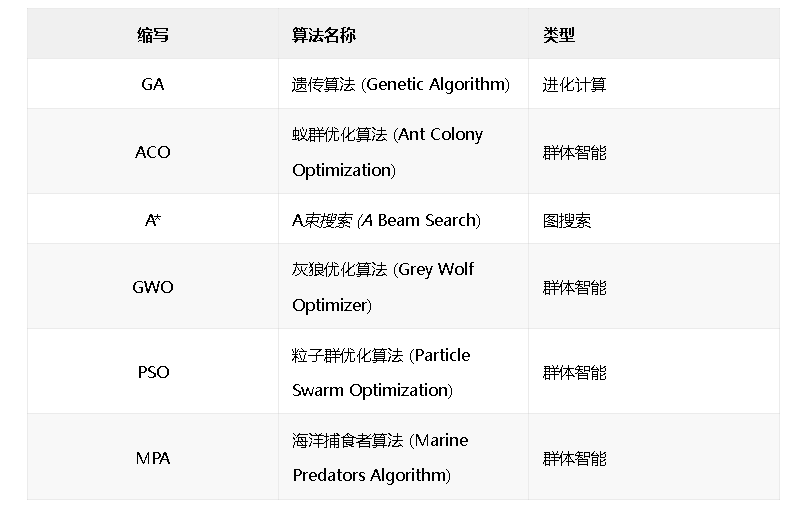
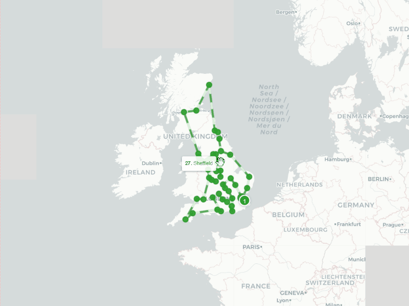

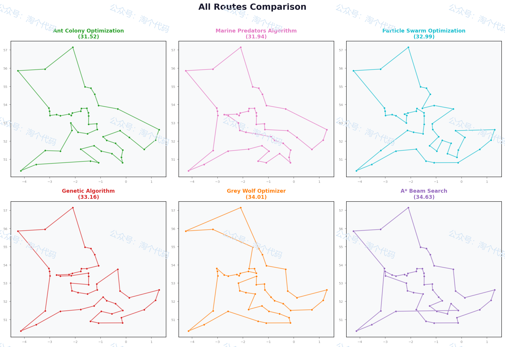
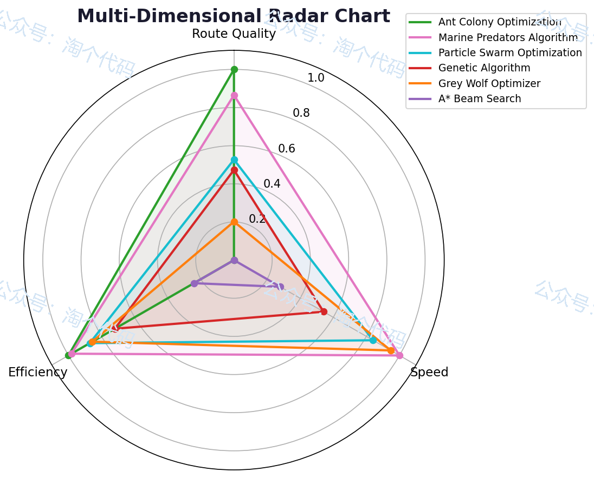
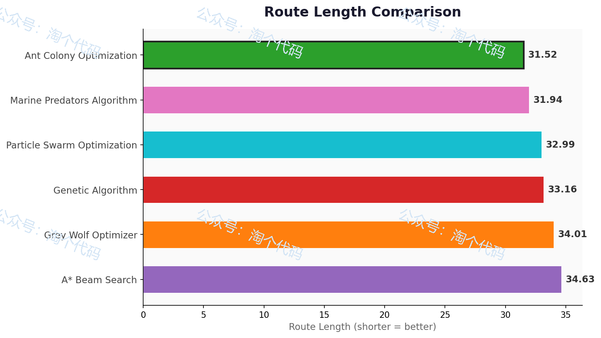
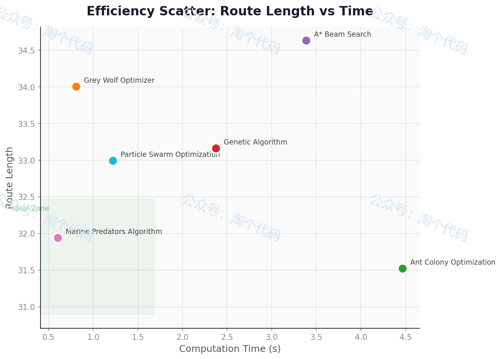
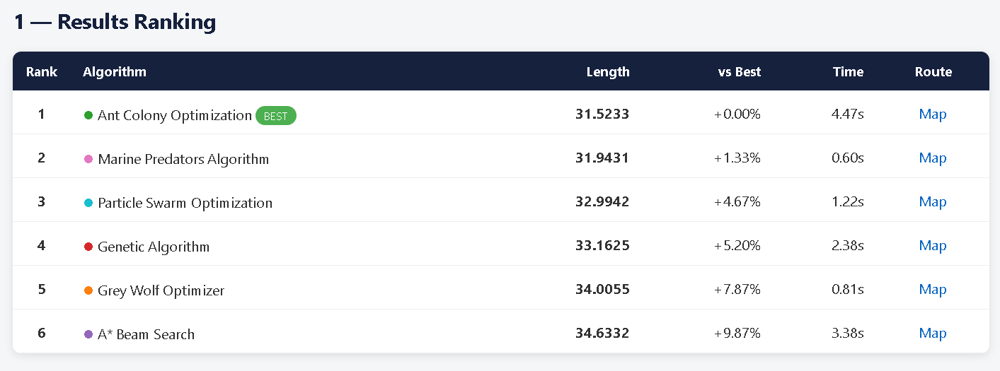
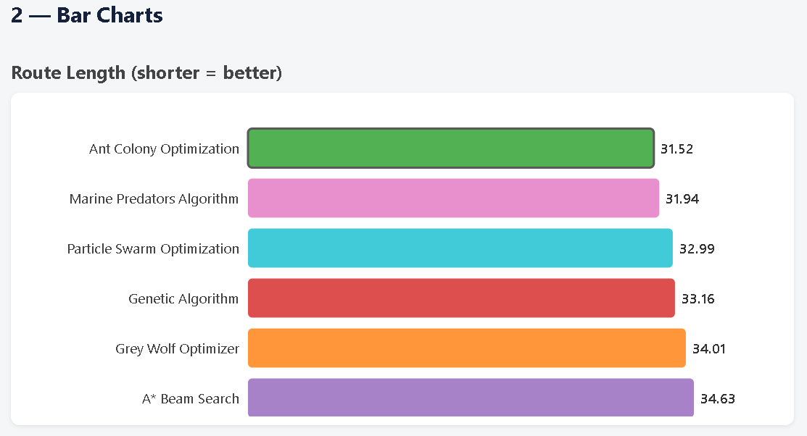
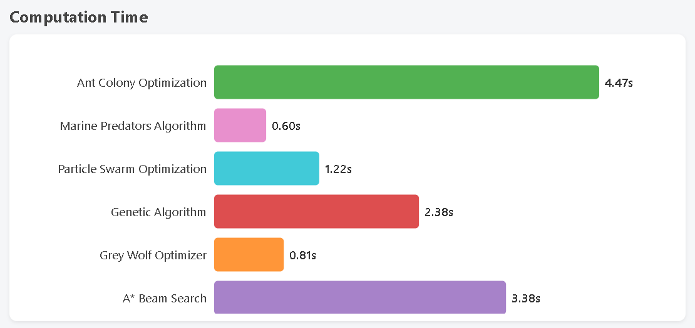
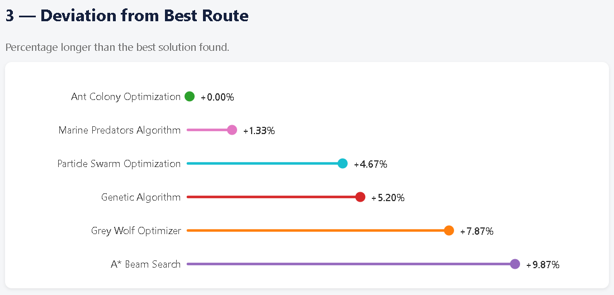
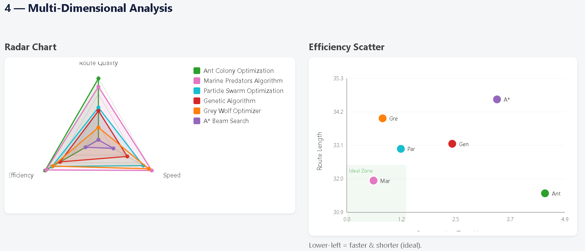
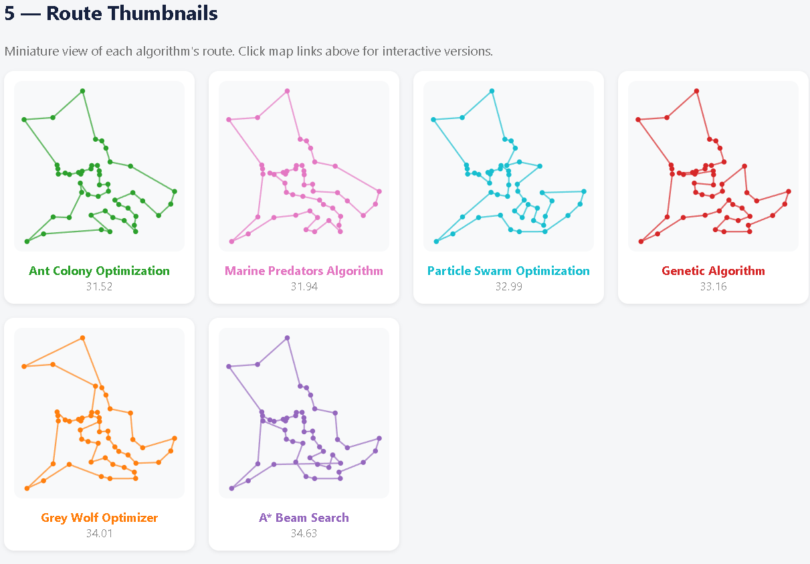
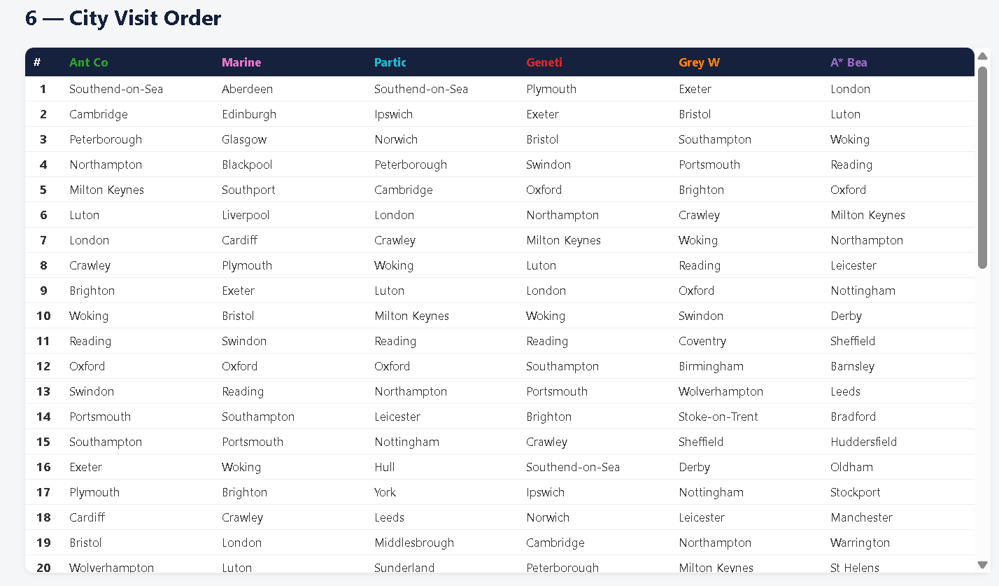

<!-- PAYMENT_BLOCK -->

## Get this dataset

- Payment link (Stripe): [Buy now](https://buy.stripe.com/3cs8yP7sY87d0vu9AB)
- Payment QR code: 

<!-- /PAYMENT_BLOCK -->
